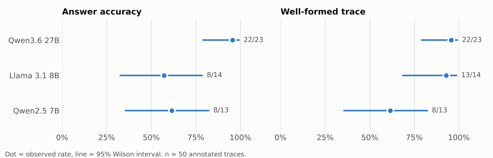

# Results

Generated by `analysis/analyze.py` from `data/annotations.csv` (50 traces, 3 models, 3 subjects, 2 prompting modes). All intervals are 95% Wilson intervals; p-values are two-sided Fisher exact tests. With this sample size the intervals are wide and the numbers below are descriptive, not conclusive.

## Accuracy by model
A trace counts as correct only when its answer matches the ground truth and follows consistently from its own steps (see the README).

| Model | n | Rate | 95% CI |
|---|---|---|---|
| Qwen3.6 27B | 23 | 22/23 (96%) | 79% to 99% |
| Llama 3.1 8B | 14 | 8/14 (57%) | 33% to 79% |
| Qwen2.5 7B | 13 | 8/13 (62%) | 36% to 82% |

## Well-formed traces by model
| Model | n | Rate | 95% CI |
|---|---|---|---|
| Qwen3.6 27B | 23 | 22/23 (96%) | 79% to 99% |
| Llama 3.1 8B | 14 | 13/14 (93%) | 69% to 99% |
| Qwen2.5 7B | 13 | 8/13 (62%) | 36% to 82% |

Qwen2.5 7B produced malformed traces more often than the other two models combined (Fisher p = 0.009).

## Prompting mode
Accuracy:

| Mode | n | Rate | 95% CI |
|---|---|---|---|
| independent | 25 | 17/25 (68%) | 48% to 83% |
| shared | 25 | 21/25 (84%) | 65% to 94% |

Well-formed traces:

| Mode | n | Rate | 95% CI |
|---|---|---|---|
| independent | 25 | 19/25 (76%) | 57% to 89% |
| shared | 25 | 24/25 (96%) | 80% to 99% |

Accuracy difference between modes: p = 0.32. Validity difference between modes: p = 0.098.

Mode and model are not balanced in this sample: Qwen3.6 27B has 8 independent and 15 shared, Llama 3.1 8B has 8 independent and 6 shared, Qwen2.5 7B has 9 independent and 4 shared. The shared condition leans on the strongest model, so the gap between modes should not be read as an effect of the mode itself.

## Accuracy by subject
| Subject | n | Rate | 95% CI |
|---|---|---|---|
| College Biology | 17 | 14/17 (82%) | 59% to 94% |
| College Medicine | 27 | 21/27 (78%) | 59% to 89% |
| High School Biology | 6 | 3/6 (50%) | 19% to 81% |

## Format failures are not reasoning failures
All 7 malformed traces still reached the correct answer (7/7). The failures were purely structural:

- The step number devolves into n instead of a number (5)
- The output cuts before finishing the reasoning. (2)

Checking output format and checking correctness are separate problems, and a pipeline that rejects malformed output would have discarded correct answers here.

## Annotation
Annotator confidence: 19 high, 23 medium, 8 low.

Explicit commitments extracted per trace:

| Model | Mean | Range |
|---|---|---|
| Qwen3.6 27B | 8.7 | 7 to 12 |
| Llama 3.1 8B | 8.4 | 5 to 12 |
| Qwen2.5 7B | 8.5 | 7 to 10 |
